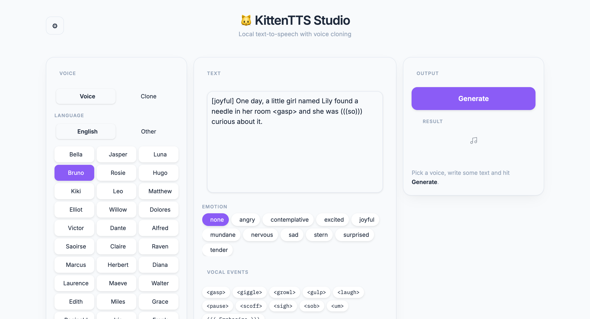

<div align="center">


### Realistic, expressive text-to-speech that runs on your CPU

Clone any voice from five seconds of audio · 47 built-in voices · 20 languages · no GPU required

<br />

<a href="https://platform.kittenml.com"></a>
<a href="https://huggingface.co/spaces/KittenML/KittenTTS-Demo"></a>
<a href="https://discord.com/invite/VJ86W4SURW"></a>
<a href="LICENSE"></a>

<br />

[**Quick start**](#-quick-start) ·
[**Studio**](#%EF%B8%8F-kittentts-studio) ·
[**Voice cloning**](#-voice-cloning) ·
[**Expression**](#-expression-controls) ·
[**Models**](#-models) ·
[**Docs**](#-documentation)

</div>

<br />

> [!TIP]
> **A free Kitten TTS API is available** at [platform.kittenml.com](https://platform.kittenml.com/).

**Kitten TTS** is an open-source text-to-speech library. Its flagship model, **KittenTTS 2**, is a
1.7B-parameter 1-bit speech language model with in-context voice cloning and expression control.
Give it five seconds of anyone's voice and it speaks your text in that voice, in real time, on a CPU.

The library also ships the original [**lightweight models**](docs/onnx-models.md) (15M–80M
parameters). Both families load through the same `KittenTTS(...)` constructor.

<br />

## ✨ Highlights

<table>
<tr>
<td width="50%" valign="top">

🎙️ **Voice cloning**<br />
<sub>Clone any speaker from 5–30 s of audio. No fine-tuning needed.</sub>

🗣️ **47 built-in voices**<br />
<sub>Includes the eight voices from KittenTTS 0.8 and nine non-English voices.</sub>

🌍 **20 languages**<br />
<sub>English, Arabic, Chinese, French, German, Hindi, Italian, Portuguese, Russian, Spanish, Japanese, Korean, Turkish, Dutch, Swedish, Danish, Finnish, Swahili, Greek, Hebrew</sub>

🎭 **Expression control**<br />
<sub><code>[emotion]</code> tags, inline <code>&lt;event&gt;</code> tags and <code>(((emphasis)))</code> spans.</sub>

</td>
<td width="50%" valign="top">

📜 **Long-form text**<br />
<sub>Splits text on sentence boundaries and joins the chunks seamlessly. Streaming is supported.</sub>

🔢 **Text preprocessing**<br />
<sub>Expands numbers, currencies, dates, units and abbreviations automatically.</sub>

🎚️ **Decoding presets**<br />
<sub>Choose stability or expressiveness for each request.</sub>

⚡ **Runs without a GPU**<br />
<sub>24 kHz output. An optimized C++ CPU engine is available through <a href="https://github.com/KittenML/kitten-tts-2-cpp">our llama.cpp fork</a>.</sub>

</td>
</tr>
</table>

<br />

## 🎧 Demo

https://github.com/user-attachments/assets/c42c236b-7b7d-41d6-944b-7527a5f30626

<br />

## 🚀 Quick start

```bash
pip install kittenml
```

That's the whole install. KittenTTS 2 is the default model and includes voice cloning. You don't need
to log in to Hugging Face. The install also brings the ONNX runtime for the
[lightweight models](docs/onnx-models.md).

```python
from kittenml import KittenTTS
import soundfile as sf

m = KittenTTS("KittenML/kitten-tts-2")

audio = m.generate("One day, a little girl named Lily found a needle in her room.", voice="Bruno")
sf.write("output.wav", audio, m.sample_rate)
```

```python
m.generate_to_file("Hello, world.", "output.wav", voice="Bruno")       # write straight to disk
m.generate("Hello, world.", voice="Luna", preset="expressive")          # livelier delivery
KittenTTS("KittenML/kitten-tts-2", weights="emb4")                      # half the download
```

`m.available_voices` lists every voice. **Bella, Jasper, Luna, Bruno, Rosie, Hugo, Kiki** and **Leo**
are the same speakers as in KittenTTS 0.8, so code written for the ONNX models keeps working.
The default weights (947 MiB) are lossless. `weights="emb4"` (506 MiB) quantises the token
embedding, which lowers quality slightly.

<details>
<summary><b>Requirements</b></summary>
<br />

| | |
|---|---|
| **OS** | Linux, Windows or macOS |
| **Python** | 3.9 or later |
| **Hardware** | A CUDA GPU with about 8 GB free, *or* a CPU with about 6 GB of RAM |
| **Disk** | About 1 GB for the model (506 MiB with `emb4`) |

A virtual environment (venv, conda, …) is recommended.

</details>

<br />

## 🖥️ KittenTTS Studio

A local web app that gives you every feature without writing code. It has a voice picker with
previews, voice cloning from an uploaded or recorded clip, one-click emotion and event tags, and
all sampling settings behind the ⚙ icon.

<p align="center">
  <picture>
    <source media="(prefers-color-scheme: dark)" srcset="assets/studio-dark.png" />
    
  </picture>
</p>

```bash
python -m venv .venv && .venv/bin/pip install -e . gradio
./start                       # opens http://127.0.0.1:7860
```

`./start` launches the app and **cleans up temporary uploads and recordings** when you stop it.
Every generation is saved to `outputs/` with a timestamped name.

| Panel | What it does |
|---|---|
| **Voice** | Choose a built-in voice (English or other languages) and hear a preview, or switch to **Clone** and upload or record a 5–30 s clip |
| **Text** | Write your script and add an emotion, vocal events or emphasis with one click |
| **Output** | Generate, listen and download. Long text is chunked and can be streamed |
| **⚙ Settings** | Switch between KittenTTS 2 and the lightweight ONNX models, pick presets, sampling, seed, chunking, weights and decoder |

### Command line

Use `speak.py` for one-off generations from the terminal:

```bash
.venv/bin/python speak.py "Hello there" -v Luna -o hello.wav
.venv/bin/python speak.py "This is me." --ref my_voice.wav      # clone a voice
.venv/bin/python speak.py "Hi" --small --list-voices            # emb4 weights, print the voices
```

<br />

## 🧬 Voice cloning

Pass `reference=` instead of `voice=`. It's the same method; the recording replaces the
built-in speaker. Use 5–30 s of a single speaker. If you leave out the transcript, Whisper writes it.

```python
audio = m.generate("This is my own voice, cloned.", reference="my_voice.wav")

# Supplying the transcript skips the Whisper pass
audio = m.generate("This is my own voice.", reference="my_voice.wav",
                   reference_text="what is actually said in the clip")
```

<details>
<summary><b>How it works and how well it does</b></summary>
<br />

The reference reaches the model by two independent routes: a speaker embedding through the
model's projection head, and the clip itself as codec tokens in the prompt. The voice's identity
holds even when one route is weak.

On the built-in voices, a generated clip scores **0.49–0.72** speaker similarity against its own
reference and **0.01–0.18** against the other 37 voices. Cloning an unseen recording scores **0.81**
against that recording.

</details>

<br />

## 🎭 Expression controls

```python
audio = m.generate(
    "[joyful] We actually won the grant <laugh> I can (((hardly))) believe it!",
    voice="Kiki",
    preset="expressive",
)
```

| Markup | Example | Effect |
|---|---|---|
| `[emotion]` at the start | `[sad] I miss you.` | Sets the mood of the whole line |
| `<event>` anywhere | `Well <sigh> fine.` | Adds a laugh, gasp, sigh, sob, um… |
| `(((word)))` | `I said (((never))).` | Stresses that span |

The model reads these tags as markup and doesn't speak them. Using a tag turns on expression
conditioning automatically. The model recognises ten emotions and ten vocal events; see
[voices and expression](docs/voices-and-expression.md) for the full lists.

> [!NOTE]
> **Beta.** Emotion control steers delivery but doesn't guarantee it. The effect varies by voice
> and sentence.

<br />

## 📜 Long text and streaming

Long input is split on sentence boundaries and generated chunk by chunk. The chunks are joined
with silence trimming and short fades, so you can't hear the seams. To start playback before the
whole text is ready, stream it:

```python
for chunk in m.generate_stream(long_text, voice="Luna"):
    play(chunk)          # each chunk is a numpy array at m.sample_rate
```

`generate_stream` takes the same arguments as `generate`, so `reference=` streams a cloned voice too.

<details>
<summary><b>What to expect from streaming</b></summary>
<br />

Streaming is **chunk-level, not token-level**. Each chunk is fully generated and decoded before
it's yielded, so you still wait for the first chunk. On an A100, a 936-character passage yielded
its first 21 s of audio after 17 s, and finished 54 s of audio in 42 s. Playback stays ahead of
generation, but there's a real initial delay.

- **Short text doesn't stream.** Input under about 380 characters fits in one chunk, so it comes
  back in a single piece.
- **Chunks are yielded raw.** `generate` smooths the seams (edge trimming, fades, consistent
  pauses). Concatenating streamed chunks directly gives slightly rougher joins.

</details>

<br />

## ⚙️ Deployment

<table>
<tr>
<td width="50%" valign="top">

#### CPU: kitten-tts-2-cpp

KittenTTS 2 runs on CPU by default because `device` is auto-detected. For the best speed, use
[**kitten-tts-2-cpp**](https://github.com/KittenML/kitten-tts-2-cpp), our llama.cpp fork. It reads the
GGUF weights in the model repository's `cpp/` directory.

</td>
<td width="50%" valign="top">

#### GPU: vLLM

For NVIDIA GPUs on Linux:

```bash
pip install "kittenml[vllm]"
```

Then pass `backend="vllm"`. See the [vLLM guide](docs/vllm.md).

</td>
</tr>
</table>

```python
from kittenml import KittenTTS

def main():
    m = KittenTTS("KittenML/kitten-tts-2", backend="vllm")
    m.generate_to_file("Hello there.", "output.wav", voice="Bruno")

if __name__ == "__main__":   # required: vLLM starts a worker process
    main()
```

<br />

## 📦 Models

**KittenTTS 2** is a speech language model:

| Model | Parameters | Size | Voices | Download |
|---|---:|---:|---|---|
| kitten-tts-2 | 1.7B | 506 MiB | 47 + cloning | [🤗 KittenML/kitten-tts-2](https://huggingface.co/KittenML/kitten-tts-2) |

**Lightweight ONNX models** are tiny and run on CPU:

| Model | Parameters | Size | Download |
|---|---:|---:|---|
| kitten-tts-mini | 80M | 80 MB | [🤗 kitten-tts-mini-0.8](https://huggingface.co/KittenML/kitten-tts-mini-0.8) |
| kitten-tts-micro | 40M | 41 MB | [🤗 kitten-tts-micro-0.8](https://huggingface.co/KittenML/kitten-tts-micro-0.8) |
| kitten-tts-nano | 15M | 56 MB | [🤗 kitten-tts-nano-0.8](https://huggingface.co/KittenML/kitten-tts-nano-0.8-fp32) |
| kitten-tts-nano (int8) | 15M | 25 MB | [🤗 kitten-tts-nano-0.8-int8](https://huggingface.co/KittenML/kitten-tts-nano-0.8-int8) |

<br />

## 📚 Documentation

| | |
|---|---|
| 📖 [**API reference**](docs/api.md) | Every argument to `generate`, streaming, and the advanced settings |
| 🗣️ [**Voices and expression**](docs/voices-and-expression.md) | The 47 voices, emotion and vocal-event tags, and languages |
| 🔊 [**Decoders**](docs/decoders.md) | How audio is decoded, and the smaller quantised decoders |
| 🔢 [**Text normalization**](docs/text-normalization.md) | How written text becomes spoken text |
| 🏗️ [**Architecture**](docs/architecture.md) | What the model is, the package layout, and vendored components |
| 🪶 [**Lightweight ONNX models**](docs/onnx-models.md) | The CPU models (15M–80M) and their API |
| 🚄 [**vLLM**](docs/vllm.md) | GPU serving, memory settings and benchmarks |

<br />

## 🤝 Community and support

<table>
<tr>
<td valign="top">

**Community**

- 💬 [Discord](https://discord.com/invite/VJ86W4SURW)
- 🌐 [kittenml.com](https://kittenml.com)
- 🐛 [GitHub Issues](https://github.com/KittenML/KittenTTS/issues)

</td>
<td valign="top">

**Commercial support**

We help teams integrate Kitten TTS, develop custom voices and arrange enterprise licensing.
[Contact us](https://docs.google.com/forms/d/e/1FAIpQLSc49erSr7jmh3H2yeqH4oZyRRuXm0ROuQdOgWguTzx6SMdUnQ/viewform?usp=preview)
or email **info@stellonlabs.com**.

</td>
</tr>
</table>

<br />

## ⚖️ License

The code in this repository is licensed under [**Apache 2.0**](LICENSE).

> [!IMPORTANT]
> **The models are licensed separately and their terms may differ.** Each model repository has
> its own license. Check it before you rely on a model; the code's license doesn't extend to the
> weights. KittenTTS 2 is released under the
> [Stellon Labs Community License](https://huggingface.co/KittenML/kitten-tts-2/blob/main/LICENSE.md).

<br />

<div align="center">
<sub>Made with 🐱 by <a href="https://kittenml.com">KittenML</a></sub>
</div>
